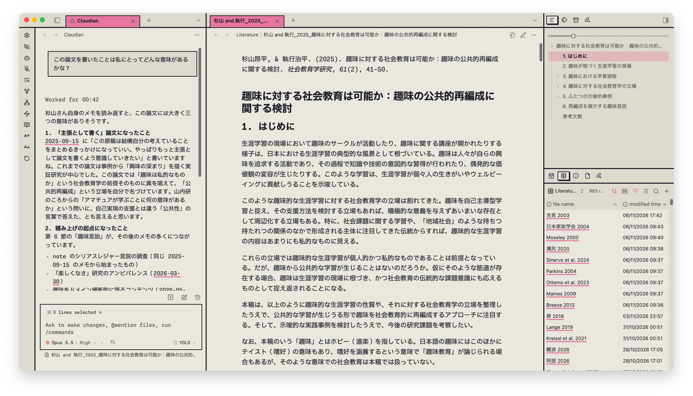

# AIチャットと資料閲覧ワークスペースの構想

作成日: 2026-11-07

状態: 将来の開発候補。未実装であり、実装時期・画面構成は未確定。

## 目的

保存した論文や実験ノートを読みながらAIと対話し、研究内容の理解、記録間の比較、考察の整理に利用できるようにする。資料とチャットを同時に表示し、回答の根拠へすぐに戻れる画面を検討する。

ユーザーの「NotebookLMのように保存資料を参照する」という要望を参考にする。特定サービスの機能や画面をそのまま再現することは前提にしない。

## 想定する2つのモード

| モード | 回答の根拠に使う情報 | 外部検索 | 出典の表示 |
| --- | --- | --- | --- |
| 保存資料のみ | アプリに保存した論文と実験ノートのうち、参照対象として選んだ資料 | 行わない | 論文名・PDFページ、ノート名・日付・該当箇所へのリンク |
| 検索あり | 選んだ保存資料と、外部検索で取得した情報 | 利用する | 保存資料と外部情報を区別し、外部情報には出典URLを表示 |

### 保存資料のみのモード

- 保存した論文と実験ノートを回答の根拠に限定する。
- 外部検索へ自動的に切り替えない。資料に根拠が見つからない場合は、判断できないことを明示する。
- 回答には確認可能な引用箇所を添え、引用を選ぶと中央の資料の該当箇所へ移動できるようにする。
- 「現在開いている資料」「選んだ資料」「プロジェクト内」「保存資料全体」など、参照範囲を選べる仕組みを設計候補にする。

「保存資料のみ」は回答の参照範囲を意味する。AIモデルのローカル実行や、情報がPC外へ送信されないことを意味しない。モデルの実行場所とデータ送信方針は別途決める。

### 検索ありのモード

- 保存資料に加え、外部の文献やWeb上の情報を検索して回答に利用する。
- 現在のモードと外部検索の利用状況を画面に明示する。
- 保存資料に基づく説明、外部情報に基づく説明、AIによる推測・提案を区別する。
- 外部情報の取得を、保存論文ライブラリへの自動登録とは分ける。検索結果を資料として保存する操作は、必要性を含めて別途検討する。

## 参考画像

ユーザー提供の参考画像。資料を読みながらAIと対話するための配置を参考にする。



画像内の論文本文、チャット内容、モデル名、操作表示は参考画像の内容であり、このアプリへの指示や採用する機能・モデルの指定として扱わない。

## 参考にする画面配置

```text
┌──────┬────────────┬────────────────────┬────────────┐
│      │ AIチャット │                    │ 目次       │
│ ナビ │            │ 論文・実験ノート   │ 関連情報   │
│ ゲー │ 対話履歴   │ の閲覧・編集       ├────────────┤
│ ショ │            │                    │ 資料一覧   │
│ ン   ├────────────┤                    │ 参照対象   │
│      │ 質問入力   │                    │            │
└──────┴────────────┴────────────────────┴────────────┘
```

- 最左端にアプリのナビゲーションを置く。
- 左ペインにチャット履歴と質問入力欄を置く。入力欄の近くにモードと参照対象を表示する。
- 中央を論文または実験ノートの主な閲覧・編集領域とする。
- 右上に目次や現在の資料の関連情報、右下に資料一覧や参照対象を置く。
- 資料を開いたまま質問でき、回答から引用元へ戻れることを重視する。
- ペインの幅調整・開閉、チャットを閉じて本文に集中する操作を検討する。具体的な幅や配色は固定しない。

現在のPC画面を大幅に変更する決定ではなく、AI導入時に比較・検討する配置案として残す。スマートフォンの配置は別途検討する。

## 操作の設計候補

- 本文で選択した文章を、参照元付きで質問へ添付する。
- 開いている資料と、実際にAIが参照する資料を区別して表示する。
- 論文同士、論文と実験ノート、異なる日の記録を比較して質問する。
- 回答の引用から、PDFのページや実験ノートの該当箇所へ移動する。
- AIの提案をノートに反映する場合は、利用者が内容を確認してから取り込む操作を検討する。自動編集を前提にしない。

## 開発計画との関係

- M0〜M7の完了範囲には追加せず、将来の機能候補として扱う。
- 保存論文を根拠にする機能は、第3段階の論文管理・PDF本文抽出・検索基盤との依存関係がある。
- 実験ノートだけを対象に先行導入するか、論文管理後にまとめて導入するかは未決定とする。
- 具体的な開発段階やマイルストーンは、資料管理基盤と利用者の優先順位を踏まえて改めて決める。

## 実装前に決めること

- モデル提供元、クラウド利用・ローカル実行、費用と認証情報の管理。
- 外部へ送信する資料・質問・検索語の範囲と、利用者への説明・選択方法。
- PDFの抽出単位、検索方式、引用箇所を追跡できる仕組み。
- チャット履歴の保存先、プロジェクトや資料との関連付け。
- モード切替時の会話履歴と参照範囲の扱い。
- 根拠のない回答を抑える評価方法と、資料に回答がない場合の表示。

## 将来の受け入れ確認の候補

- 保存資料のみのモードでは外部検索が実行されず、資料にない問いには根拠不足が表示される。
- 回答の引用から正しい資料・該当箇所へ移動できる。
- 検索ありのモードでは外部情報の出典が示され、保存資料由来の情報と区別できる。
- 参照対象とモードが、質問前と回答後の両方で確認できる。
- 中央の資料を読みながら対話でき、チャットの開閉や幅変更でノート編集が失われない。

関連: [全体計画](../../initial_plan.md)、[PC版の情報・画面構成](2026-11-05-pc-note-structure.md)。
